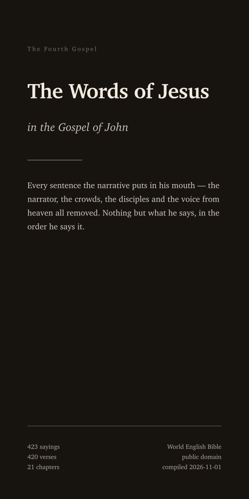
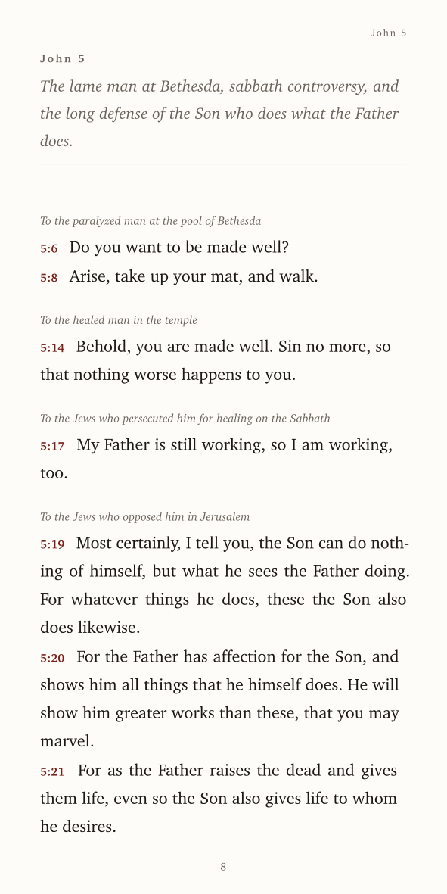

# The Words of Jesus in the Gospel of John

Every sentence the Fourth Gospel attributes to Jesus — pulled out of the narrative, in order,
with the narrator, the crowds, the disciples and the Father's voice from heaven removed.

**423 sayings · 420 of John's 879 verses · 8,119 words · 21 chapters**

<p align="left">
  
  
</p>

| | |
|:--|:--|
| **Read on a phone** | [`jesus-in-john.pdf`](jesus-in-john.pdf) — 100 × 200 mm, phone-shaped pages ([latest release download](../../releases/latest)) |
| **Read on GitHub** | [`jesus-in-john.md`](jesus-in-john.md) — the same text in markdown |
| **Reuse the data** | [`data/jesus-words.json`](data/jesus-words.json) — verse-keyed JSON |
| **Translation** | World English Bible (public domain, modern English) |
| **Checked** | every saying machine-verified as a verbatim substring of its verse |

## What is and isn't here

Included: direct speech — questions, commands, one-word replies, prayers to the Father,
Scripture he quotes, and speech after the resurrection. Sayings that run across a verse break are
joined into one paragraph so the sentence reads as a sentence; the verse range stays on the line.

Excluded on purpose:

- the narrator's commentary, even where it sounds like him (1:1–18, 3:31–36, 7:39, 12:37–43);
- the Father's voice from heaven (12:28);
- John the Baptist (1:15–34, 3:27–30), the disciples, the Samaritan woman, Nicodemus, Martha,
  Mary, Pilate, the crowds, and the healed blind man;
- words other characters *report* he said (4:53, 6:41, 7:36, 8:22, 9:11 …) — those are their
  claims, not his speech;
- the narrator's own four citations of his words, which are collected in the appendix instead.

## Where the attribution is contested

Two flags, both marked † in the text and in the data:

1. **3:13–21** — the most famous passage in the book. Many editions print it as the evangelist's
   commentary; many print it in red. It is included here with `confidence: medium` and a note,
   because the brief was *everything attributed* — silently dropping 3:16 would be the bigger error.
2. **8:1–11** (the woman taken in adultery) — absent from the earliest manuscripts and printed in
   brackets in most modern Bibles. The words are unambiguously Jesus inside John's narrative;
   the note is about the text, not the speaker.

## The numbers

| Metric | Value |
|:--|--:|
| Sayings (speech units) | 423 |
| Verses containing his speech | 420 of 879 (48%) |
| Whole-verse / partial-verse sayings | 269 / 154 |
| Words spoken | 8,119 |
| Average saying | 19.2 words |
| Longest single saying | 58 words (8:44) |
| Sayings carrying a flag | 13 |

Most frequent terms in his mouth (English of this translation, not the Greek):

- **Father** — 117×
- **world** — 65×
- **sent** — 45×
- **believe** — 40×
- **life** — 40×
- **truth** — 22×
- **works** — 21×
- **love** — 20×
- **sheep** — 19×
- **light** — 17×

## Chapter index

| Chapter | Sayings | Verses | Scene |
|:--|--:|:--|:--|
| John 1 | 8 | 1:38 → 1:51 | The Word becomes flesh; the first disciples follow |
| John 2 | 5 | 2:4 → 2:19 | Water into wine at Cana |
| John 3 | 17 | 3:3 → 3:21 | Nicodemus comes at night |
| John 4 | 20 | 4:7 → 4:50 | The woman at the well |
| John 5 | 33 | 5:6 → 5:47 | The lame man at Bethesda |
| John 6 | 37 | 6:5 → 6:70 | Bread for five thousand |
| John 7 | 17 | 7:6 → 7:38 | At the Feast of Tabernacles |
| John 8 | 40 | 8:7 → 8:58 | The woman taken in adultery |
| John 9 | 8 | 9:3 → 9:41 | A man born blind is healed |
| John 10 | 29 | 10:1 → 10:38 | The good shepherd |
| John 11 | 17 | 11:4 → 11:44 | Lazarus dies and is raised |
| John 12 | 20 | 12:7 → 12:50 | Anointed at Bethany |
| John 13 | 23 | 13:7 → 13:38 | The feet washed |
| John 14 | 28 | 14:1 → 14:31 | The way |
| John 15 | 27 | 15:1 → 15:27 | The vine and the branches |
| John 16 | 29 | 16:1 → 16:33 | The Comforter |
| John 17 | 26 | 17:1 → 17:26 | The prayer to the Father |
| John 18 | 11 | 18:4 → 18:37 | Arrested in the garden |
| John 19 | 5 | 19:11 → 19:30 | Crucified |
| John 20 | 10 | 20:15 → 20:29 | The empty tomb |
| John 21 | 13 | 21:5 → 21:22 | Breakfast on the shore of Tiberias |

## How it was checked

`tools/verify.py` enforces four things and exits non-zero on any failure:

1. every reference exists in the source text;
2. every saying's text is a **verbatim substring** of that verse (quote-normalised) — no
   paraphrase, no stitching, no invented words;
3. no duplicated sayings, no crossed chapter boundaries;
4. a coverage pass listing every verse that contains quoted speech near a naming of Jesus and is
   still uncovered, for manual review.

The extraction was done in two independent halves (chapters 1–11 and 12–21) against the same
stored source text, then reconciled; the † flags mark where reasonable readings of John's Greek
differ.

## Reproduce it

```bash
make            # data → verify → PDF → preview images
# or step by step:
python3 tools/build.py     # data/jesus-words.json, jesus-in-john.md, build/content.typ
python3 tools/verify.py    # schema, verbatim, duplicate and coverage checks
typst compile build/doc.typ jesus-in-john.pdf
```

The typesetting lives in [`build/doc.typ`](build/doc.typ) — 100 × 200 mm pages, Charter, one column,
running chapter head, PDF bookmarks per chapter. The structure lives in [`build/content.typ`](build/content.typ),
generated at build time so the prose never drifts from the data.

Source text fetched once from [bible-api.com](https://bible-api.com) (`translation=web`) and stored
in [`data/verses.json`](data/verses.json), so the build is offline and deterministic.

## Notes on the text

The World English Bible is a public-domain modern-English revision of the American Standard
Version of 1901. Only the quotation marks around his speech were removed — nothing else was
edited. Verse numbers are the handle back to the full scene in any Bible.

Compilation, data and tooling: public domain (CC0). The scripture text is public domain.
